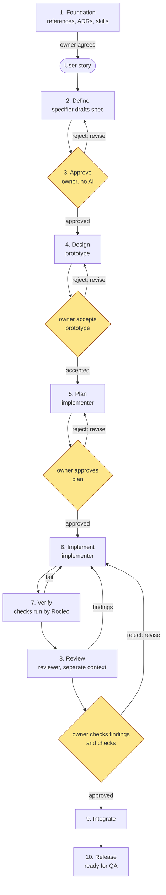

# Agentic flow

How a functional user story becomes a QA-ready increment in this repository, which agents and skills take part, and where a person decides.

The flow is defined in [`.roclec/flow.toml`](.roclec/flow.toml), agreed by the owner like any other project reference; [`docs/flow.md`](docs/flow.md) is its generated view. This file explains it. When they differ, `flow.toml` wins.

## Tools

- **Claude Code** (desktop app) runs every AI step. Model: Claude Opus 5.5, used by the main session and inherited by the subagents.
- **Roclec** (spec-driven development framework) keeps the specs, approvals, runs, reviews and integrations as versioned, hash-pinned records under `.roclec/`. The spec is the source of truth: code is verified against the approved spec, and an edit to an agreed spec or reference invalidates it until a person agrees it again.

Why this combination: spec-driven development turns each story into verifiable acceptance criteria before any code; Roclec adds what a prompt alone cannot enforce: gates that refuse to implement without an approved spec, approvals tied to the exact content approved, evidence tied to the exact code tested and a review done in a separate context.

## Agents and skills

| Who | Definition | Responsibility |
| --- | --- | --- |
| Coordinator | Main Claude Code session, entry skill `roclec-coordinator` | Runs the flow, talks to the owner, runs foundation, design, integration and release, and delegates the rest |
| Specifier | Subagent [`.claude/agents/roclec-specifier.md`](.claude/agents/roclec-specifier.md) | Drafts the spec (change bundle) of a story; never approves |
| Implementer | Subagent [`.claude/agents/roclec-implementer.md`](.claude/agents/roclec-implementer.md) | Plans, implements and runs the checks of an approved change; never changes the approved intent |
| Reviewer | Subagent [`.claude/agents/roclec-reviewer.md`](.claude/agents/roclec-reviewer.md) | Reviews the candidate in a separate context and records findings; read-only except for its report |
| Owner | The person | Agrees references and ADRs, approves specs, accepts prototypes and plans, decides on findings before integration |

Each subagent definition declares its instructions, allowed tools, inputs and outputs.

Skills:

- **Procedure skills** `roclec-*` (installed by Roclec): how to specify, plan, implement, review and integrate.
- **Project knowledge skills** (ours, agreed like references): [`story-spec`](.agents/skills/story-spec/SKILL.md) for the specifier in define, [`country-content`](.agents/skills/country-content/SKILL.md) for plan, implement and review.
- **Official skills** pinned in `skills-lock.json`: `angular-developer`, `strapi-docs-mcp` and the design skills listed in [docs/design.md](docs/design.md).

## Diagram

Foundation runs once and again whenever a reference changes; steps 2 to 10 run once per user story.

## Steps

| Step | Description | AI used? | AI, agent, subagent or skill | Deliverable | Human in the loop |
| --- | --- | --- | --- | --- | --- |
| 1. Foundation | Agree the references every change depends on: context, principles, stack, architecture, engineering, verification, design, the flow itself, ADRs and knowledge skills. | Yes | Coordinator with `roclec-foundation` and `roclec-constitution`; Claude Opus 5.5 | `docs/`, `docs/adr/`, `.roclec/constitution.md`, `.agents/skills/`; agreements in `.roclec/decisions/` | Owner agrees each document against CR-001 to CR-003. On rejection the coordinator revises it; until agreed, implementation is blocked. |
| 2. Define | Turn the story into a spec: origin criteria, gap checklist, acceptance criteria with their verification method, coverage, cited ADRs. Open questions go to the owner. | Yes | Specifier subagent with `roclec-specify`, `roclec-clarify`, `roclec-analyze`, `roclec-checklist` and `story-spec` | Change bundle in `.roclec/changes/CHG-NNN/` | Owner answers the questions the specifier raises; nothing is assumed. |
| 3. Approve | Accept the exact spec; approval freezes its digest. | **No** | — | Approval in `.roclec/decisions/` | Owner evaluates CR-004 to CR-008. On rejection: corrections recorded, specifier revises, owner approves the new revision. |
| 4. Design | Interaction specification and a prototype of the screen, shown with Colombia's and Chile's content. | Yes | Coordinator with `roclec-ux`, `roclec-prototype` and the design skills | `docs/prototypes/CHG-NNN.html`; acceptance in `.roclec/decisions/` | Owner accepts the prototype against CR-009 and CR-010. On rejection the prototype is revised. |
| 5. Plan | Assign the change to a release and plan tasks per acceptance criterion within the component's paths. | Yes | Implementer subagent with `roclec-plan`, `roclec-tasks`, `roclec-release` and `country-content` | `docs/plans/CHG-NNN/`, `.roclec/releases/` | Owner approves the plan before any code (pre-implement, CR-011). On rejection the plan is revised. |
| 6. Implement | Write the code and tests of the approved change. | Yes | Implementer subagent with `roclec-implement`, `country-content`, `angular-developer`, `strapi-docs-mcp` | `apps/web/`, `apps/cms/`, `packages/shared/`, `e2e/` | — (bounded by the approved spec and plan). |
| 7. Verify | Run the configured checks on the exact candidate and record the evidence per acceptance criterion. | Yes | Implementer subagent; checks executed by Roclec (`run verify`) | `.roclec/runs/` | — (a failing check sends the change back to implement). |
| 8. Review | Independent review of the candidate; every finding has a severity and stays open until resolved or decided. | Yes | Reviewer subagent with `roclec-reviewer` and `country-content`, in a context separate from the implementation | Review report in `.roclec/evidence/` | Owner decides any finding the reviewer cannot resolve (accept, fix or defer). |
| 9. Integrate | Integrate the verified, reviewed candidate. | Yes | Coordinator with `roclec-converge` | `.roclec/integrations/`, `specs/capabilities/` | Owner checks that findings are resolved and checks pass before integration (pre-integrate, CR-012). On rejection the change goes back to implement. |
| 10. Release | Verify the combined release, prepare it and record the Git publication: the increment is ready for QA. | Yes | Coordinator with `roclec-release` | `.roclec/releases/` | Owner asks for the publication; agents never push, tag or deploy on their own. |

The criteria CR-001 to CR-012 are listed in [docs/flow.md](docs/flow.md#criteria). Every human decision is recorded with the owner's evaluation of each criterion; agents never fill it in.

## Traceability

User story → spec (`.roclec/changes/CHG-NNN/`, origin `US-NN`) → ADRs cited and pinned in the spec → code (the run records the exact files tested) → tests (acceptance criterion IDs in test titles, results in `.roclec/runs/`) → review (`.roclec/evidence/`, linked to the same candidate) → integration (`.roclec/integrations/`). `./.roclec/run inspect --change CHG-NNN` shows the whole thread of one change.

## Session logs

Agent sessions are imported into Roclec as evidence and versioned twice: the unedited original in `.roclec/runtime/sessions/EVD-*/` and a copy in `.roclec/evidence/EVD-*.session` with secrets and email addresses redacted as configured in [`.roclec/project.toml`](.roclec/project.toml) (`secret_env`, `redact_patterns`).
