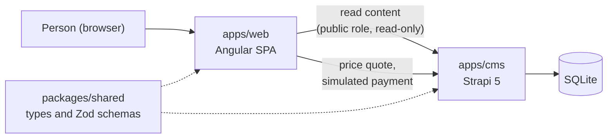

# Architecture

How the product is built. It applies [ADR-001](adr/ADR-001-multi-country-content.md) and the [principles](../.roclec/constitution.md); technologies are in [docs/stack.md](stack.md).

## Overview



## Parts

### `apps/web`: Angular single-page application

- **Country resolution:** the first route segment is the country code (`/co/…`, `/cl/…`); the root lets the person choose a country (ADR-001).
- **Content client:** reads the country, its wizard steps with their fields, its plans and its terms from Strapi, filtered by country. Every response is validated with the shared Zod schemas before use; invalid or missing content shows a controlled message (P3).
- **Wizard shell:** builds the wizard from the country's step configuration. Each step type maps to one component: form step, plan list, summary and payment. Navigation and the progress indicator work for any number of steps; no step count or order is hard-coded.
- **Form step:** generated with Angular Signal Forms from the field configuration (type, required flag, validations, help text, error message, order).
- **Wizard state:** a signals-based store per country holds the entered data and the chosen plan, mirrored to `sessionStorage`. Data survives going back and reloading the page and is discarded when the tab closes.
- **Formatting:** prices and numbers use the country's currency and locale with the `Intl` API.

#### Front-end structure

Organized by feature, with container and presentational components. File naming conventions are defined in the engineering reference.

```
apps/web/src/app/
├─ core/                  # application-wide singletons
│  ├─ country/            # country resolution from the route
│  ├─ content/            # Strapi client and Zod validation
│  └─ wizard-state/       # signals store mirrored to sessionStorage
├─ features/
│  ├─ country-selection/
│  └─ wizard/
│     ├─ shell/           # container: steps, progress, navigation
│     └─ steps/           # one folder per step type
│        ├─ form-step/
│        │  ├─ (container)
│        │  ├─ components/  # presentational, e.g. dynamic field
│        │  ├─ services/
│        │  └─ models/
│        ├─ plan-list/
│        └─ summary/
└─ shared/
   ├─ ui/                 # presentational components based on Spartan UI
   └─ utils/              # pure functions (formatting, masking)
```

- **Containers** inject state and services, and pass data down.
- **Presentational components** receive inputs and emit outputs only; they inject no state or services and are tested in isolation.
- **Dependency rules:** `features` may import `core` and `shared`; `core` may import `shared`; `shared` imports nothing from the application; features do not import each other. Inside `wizard`, the shell selects the step component by step type.
- Content models come from `packages/shared`; feature `models/` hold only view models of that feature.

### `apps/cms`: Strapi 5 with SQLite

- **Content types:** `Country`, wizard steps, form fields, plans and terms, related as in ADR-001, with draft and publish.
- **Custom endpoints:**
  - *Price quote:* applies the documented simulated rule to the plan's base price and the entered data and returns the final price.
  - *Simulated payment:* returns success or failure and, on success, a simulated quote number.
  - Both are stateless: no quote, payment or personal data is stored (P5).
- **Public role:** read-only access (`find`, `findOne`) to the content types the wizard reads, plus the two custom endpoints. Nothing else. No API token reaches the browser (P4).
- **Seed data:** Colombia and Chile, with different step configurations.

#### CMS structure

Strapi's standard layout, with these project-specific placements:

```
apps/cms/
├─ config/                      # server, database (SQLite), plugins
├─ database/migrations/
├─ src/
│  ├─ api/
│  │  ├─ country/ wizard-step/ form-field/ plan/ terms/   # one per content type
│  │  │  └─ content-types/ controllers/ routes/ services/
│  │  └─ quote/                 # custom endpoints, no content type
│  │     └─ controllers/ routes/ services/
│  ├─ components/<category>/    # reusable components: validation, option, coverage…
│  └─ index.ts                  # bootstrap: public role permissions and seed data
└─ types/generated/             # generated types, exposed through packages/shared
```

| Piece | Placement | Why |
| --- | --- | --- |
| Price quote and simulated payment | `src/api/quote/`, an API without a content type | Strapi's standard way to add endpoints; it creates no tables, so the endpoints stay stateless |
| Simulated price rule | A pure function in the `quote` service | Unit-tested without starting Strapi |
| Public role permissions | Applied in code during bootstrap, idempotently | A fresh `docker compose up` always yields the same permissions, and P4 can be reviewed in code |
| Seed data for Colombia and Chile | A seed module run during bootstrap only when the database is empty | One command starts the project with data for both countries without overwriting later edits |

### `packages/shared`

TypeScript types generated from the Strapi content types and the Zod schemas that validate them, used by both applications.

### `e2e`

Playwright tests run against the full stack started with Docker Compose.

## Request flow

1. The person opens `/{country}/…`; the application loads the country, its steps, plans and terms and validates them.
2. Each form step stores its valid data in the wizard state; the next step is enabled only when the current one is valid.
3. The plan list shows the country's active, published plans; on selection, the application asks the price endpoint for the final price.
4. The summary shows the entered data, the chosen plan and its final price; after the terms are accepted, the payment endpoint is called once and its result is shown.

## Runtime

Docker Compose starts two services with one command: `cms` (Strapi with its SQLite file in a volume and the seed data) and `web` (the built Angular application served as static files).

## Decisions and alternatives

| Decision | Chosen | Alternatives considered |
| --- | --- | --- |
| Wizard state between steps | Signals store mirrored to `sessionStorage` | In memory only (lost on reload); `localStorage` (personal data kept on disk longer) |
| Content access without secrets | Browser calls Strapi with a read-only public role | Backend-for-frontend or server-side rendering holding a read token |
| Simulated price and payment | Stateless custom endpoints in Strapi | Pure functions and a mock service in the front end |
| Rendering | Static single-page application | Server-side rendering with Node |
| Front-end structure | By feature, with container and presentational components | By feature without that split; by file type (`components/`, `services/`, `models/` at the root) |
