<!-- roclec-managed-view sha256=65a2fd7b810001f7d6f86f91aa5eec48fbd18b367a11879c7d1b1308c059650f -->
# Project flow

Generated from `.roclec/flow.toml` by `roclec views --write`. Do not edit by hand.

| Step | Stage | Description | AI | Role | Skills and model | Deliverables | Human checkpoint | Criteria | On reject |
| --- | --- | --- | --- | --- | --- | --- | --- | --- | --- |
| 1 | foundation | Agree the project references (constitution, ADRs, process) before changes depend on them. | yes | coordinator | session model | — | owner | CR-001, CR-002, CR-003 | revise |
| 2 | define | Capture discovery and draft the capability/change bundle with sources and acceptance criteria. | yes | specifier | session model | — | — | — | — |
| 3 | approve | Approve the exact intent of the change; approval freezes its digest. | no: Only a person decides which intent is accepted. | owner | — | — | owner | CR-004, CR-005, CR-006, CR-007, CR-008 | revise |
| 4 | design | Produce and review user-facing design or prototypes before implementation. | yes | coordinator | session model | — | owner | CR-009, CR-010 | revise |
| 5 | plan | Assign the approved change to a release and plan the implementation work. | yes | implementer | session model | — | — | — | — |
| 6 | implement | Implement the approved change within its declared scope. | yes | implementer | session model | — | owner (pre-implement) | CR-011 | revise |
| 7 | verify | Run the configured checks and record evidence covering the acceptance criteria. | yes | implementer | session model | — | — | — | — |
| 8 | review | Independent review of the candidate; findings stay open until resolved or decided. | yes | reviewer | session model | — | — | — | — |
| 9 | integrate | Integrate the verified, reviewed candidate per component. | yes | coordinator | session model | — | owner (pre-integrate) | CR-012 | revise |
| 10 | release | Verify the combined release, prepare it and record the existing Git publication. | yes | coordinator | session model | — | — | — | — |

## Criteria

| ID | Text |
| --- | --- |
| CR-001 | The reference states only what the owner decided; nothing was assumed by the agent. |
| CR-002 | The reference is consistent with the business context, functional scope and user stories of the product. |
| CR-003 | The reference does not contradict any reference already agreed. |
| CR-004 | Each origin criterion is mapped to ACs that actually satisfy it; every exclusion or deferral has a reason the owner accepts. |
| CR-005 | The proposal states observable behavior without ambiguity, including limits and error cases. |
| CR-006 | Every AC names how it will be verified (unit test, e2e test or declared manual check). |
| CR-007 | Gaps in the origin (missing states, limits, country differences) are resolved as derived ACs or as answers from the owner; none is silently assumed. |
| CR-008 | The proposal cites every agreed ADR it depends on; any new architecture decision it needs is raised as a proposed ADR, not decided inside the proposal. |
| CR-009 | The prototype demonstrates every user-facing AC of the approved proposal and adds no behavior it does not state. |
| CR-010 | The prototype shows the screen with Colombia's and with Chile's content. |
| CR-011 | Plan and tasks cover every AC, stay within the component's paths and follow the agreed ADRs. |
| CR-012 | Review findings are resolved or decided by the owner, and all checks pass. |

## Diagram

```mermaid
flowchart LR
  S1["1. foundation [checkpoint]"]
  S2["2. define"]
  S3["3. approve [person] [checkpoint]"]
  S4["4. design [checkpoint]"]
  S5["5. plan"]
  S6["6. implement [checkpoint]"]
  S7["7. verify"]
  S8["8. review"]
  S9["9. integrate [checkpoint]"]
  S10["10. release"]
  S1 --> S2 --> S3 --> S4 --> S5 --> S6 --> S7 --> S8 --> S9 --> S10
  classDef person fill:#fde68a,stroke:#92400e;
  classDef checkpoint stroke:#1d4ed8,stroke-width:3px;
  class S3 person;
  class S1,S3,S4,S6,S9 checkpoint;
```

## Flow learning

Derived from the project records by `roclec views --write`. Counts and lists only.

### Flow revisions

Agreements of the process reference in decision order, with the process FUTs each one addresses.

| Decision | Flow sha256 | Actor | Reason | Process FUTs addressed |
| --- | --- | --- | --- | --- |
| `3754daad79d8b28bfe5b36d05bc2875fff81cc45c51bfa237fd3d51dfe41760f` | `8a39e2be42b3c45936ac8ed9ca6dd11c80f2bb563fcfb0b1d3ecc24443e9cbce` | luis-cardozo | Owner agreed the flow after reviewing each criterion, the checkpoints and the seeded stage roles one by one. | — |

### Open process FUTs

Process FUTs captured or under evaluation that no flow agreement cites.

None recorded.

### Rejections by stage

None recorded.

### Findings by severity and status

None recorded.

### Stages with ai = false

| Stage | Role | Reason |
| --- | --- | --- |
| approve | owner | Only a person decides which intent is accepted. |

### Agent sessions by role and stage

None recorded.

### Retrospective

What the records cannot show (what did not work as expected, what would change with a larger team, which AI-use decisions to revisit) belongs in the project-owned [docs/flow-retro.md](flow-retro.md).
