<!-- roclec-managed-view sha256=92e97140baafd9718cedd3a1a5f34824b958affbe827a415efeaafa092b977a4 -->
# Project flow

Generated from `.roclec/flow.toml` by `roclec views --write`. Do not edit by hand.

| Step | Stage | Description | AI | Role | Skills and model | Deliverables | Human checkpoint | Criteria | On reject |
| --- | --- | --- | --- | --- | --- | --- | --- | --- | --- |
| 1 | foundation | Agree the project references (constitution, ADRs, process) before changes depend on them. | yes | coordinator | session model | `docs`, `docs/adr`, `.roclec/constitution.md`, `.agents/skills` | owner | CR-001, CR-002, CR-003 | revise |
| 2 | define | Capture discovery and draft the capability/change bundle with sources and acceptance criteria. | yes | specifier | `story-spec` session model | `.roclec/changes` | — | — | — |
| 3 | approve | Approve the exact intent of the change; approval freezes its digest. | no: Only a person decides which intent is accepted. | owner | — | `.roclec/decisions` | owner | CR-004, CR-005, CR-006, CR-007, CR-008 | revise |
| 4 | design | Produce and review user-facing design or prototypes before implementation. | yes | coordinator | session model | `docs/prototypes` | owner | CR-009, CR-010 | revise |
| 5 | plan | Assign the approved change to a release and plan the implementation work. | yes | implementer | `country-content` session model | `docs/plans`, `.roclec/releases` | — | — | — |
| 6 | implement | Implement the approved change within its declared scope. | yes | implementer | `country-content` session model | `apps/web`, `apps/cms`, `packages/shared`, `e2e` | owner (pre-implement) | CR-011 | revise |
| 7 | verify | Run the configured checks and record evidence covering the acceptance criteria. | yes | implementer | session model | `.roclec/runs` | — | — | — |
| 8 | review | Independent review of the candidate; findings stay open until resolved or decided. | yes | reviewer | `country-content` session model | `.roclec/evidence` | — | — | — |
| 9 | integrate | Integrate the verified, reviewed candidate per component. | yes | coordinator | session model | `.roclec/integrations`, `specs/capabilities` | owner (pre-integrate) | CR-012 | revise |
| 10 | release | Verify the combined release, prepare it and record the existing Git publication. | yes | coordinator | session model | `.roclec/releases` | — | — | — |

## Criteria

| ID | Text |
| --- | --- |
| CR-001 | The reference states only what the owner decided; nothing was assumed by the agent. |
| CR-002 | The reference is consistent with the business context, functional scope and user stories of the product. |
| CR-003 | The reference does not contradict any reference already agreed. |
| CR-004 | Each origin criterion is mapped to ACs that actually satisfy it; every exclusion or deferral has a reason the owner accepts. |
| CR-005 | The proposal states observable behavior without ambiguity, including limits and error cases. |
| CR-006 | Every AC names how it will be verified (unit test, e2e test or declared manual check). |
| CR-007 | Gaps in the origin (missing states, limits, country differences) are resolved as derived ACs or as answers from the owner; none is silently assumed. |
| CR-008 | The proposal cites every agreed ADR it depends on; any new architecture decision it needs is raised as a proposed ADR, not decided inside the proposal. |
| CR-009 | The prototype demonstrates every user-facing AC of the approved proposal and adds no behavior it does not state. |
| CR-010 | The prototype shows the screen with Colombia's and with Chile's content. |
| CR-011 | Plan and tasks cover every AC, stay within the component's paths and follow the agreed ADRs. |
| CR-012 | Review findings are resolved or decided by the owner, and all checks pass. |

## Diagram

```mermaid
flowchart LR
  S1["1. foundation [checkpoint]"]
  S2["2. define"]
  S3["3. approve [person] [checkpoint]"]
  S4["4. design [checkpoint]"]
  S5["5. plan"]
  S6["6. implement [checkpoint]"]
  S7["7. verify"]
  S8["8. review"]
  S9["9. integrate [checkpoint]"]
  S10["10. release"]
  S1 --> S2 --> S3 --> S4 --> S5 --> S6 --> S7 --> S8 --> S9 --> S10
  classDef person fill:#fde68a,stroke:#92400e;
  classDef checkpoint stroke:#1d4ed8,stroke-width:3px;
  class S3 person;
  class S1,S3,S4,S6,S9 checkpoint;
```

## Knowledge skills

Registered skill references (`roclec reference add <id> --role skill`). A skill applies to its components at the stages whose `skills` list it, or at every stage when no stage lists it. `roclec inspect --change CHG-ID` gives each role this list with its fingerprints.

| Skill | Path | Components | Stages |
| --- | --- | --- | --- |
| `country-content` | [.agents/skills/country-content](../.agents/skills/country-content) | app | plan, implement, review |
| `story-spec` | [.agents/skills/story-spec](../.agents/skills/story-spec) | app | define |

### Skills by stage

| Stage | Skills (components) |
| --- | --- |
| define | `story-spec` (app) |
| plan | `country-content` (app) |
| implement | `country-content` (app) |
| review | `country-content` (app) |

## Flow learning

Derived from the project records by `roclec views --write`. Counts and lists only.

### Flow revisions

Agreements of the process reference in decision order, with the process FUTs each one addresses.

| Decision | Flow sha256 | Actor | Reason | Process FUTs addressed |
| --- | --- | --- | --- | --- |
| `3754daad79d8b28bfe5b36d05bc2875fff81cc45c51bfa237fd3d51dfe41760f` | `8a39e2be42b3c45936ac8ed9ca6dd11c80f2bb563fcfb0b1d3ecc24443e9cbce` | luis-cardozo | Owner agreed the flow after reviewing each criterion, the checkpoints and the seeded stage roles one by one. | — |
| `6f9144f765b544da65265126ffb05fa52de419eae5ecacecc6f51e46200d544b` | `17d14ca0bada994fde64c0d81dc98681311f7b02520fda722d5e1f68c76fa2ba` | luis-cardozo | Owner agrees the flow with knowledge skills scoped by stage: story-spec in define; country-content in plan, implement and review. | — |
| `ac01a6e9eba0b2c3c0695c21b32b7fd9a7e33e1fda07fc6d7717d7ce92a3b767` | `3ae780aad6b1fc33890a0dff47645cf0515ef6319f7c53e9c0a04f98cf4a49fc` | luis-cardozo | Owner agrees the flow with the deliverables of every stage declared. | — |

### Open process FUTs

Process FUTs captured or under evaluation that no flow agreement cites.

None recorded.

### Rejections by stage

| Stage | Rejections | Open |
| --- | --- | --- |
| approve | 3 | 0 |

| Stage | Subject | Entity | Consequence | State | Decision |
| --- | --- | --- | --- | --- | --- |
| approve | change | CHG-001 | revise | closed | `3a7a0af250436b204f9705e775ac1c3875a945bea6f5ec78d96bc5f3e55ec9da` |
| approve | change | CHG-002 | revise | closed | `9c0e45cfaecd5ce02196c07252d3a0c720dda48ee57d14629ca8933913f47fb2` |
| approve | change | CHG-003 | revise | closed | `01595ad54c3cd543149d446c5cf05ae72a92586e9519b1dce3a68f7fb9b53e61` |

### Findings by severity and status

| Severity | open | still-open | fixed | accepted | deferred | invalid |
| --- | --- | --- | --- | --- | --- | --- |
| info | 0 | 4 | 1 | 8 | 0 | 0 |
| minor | 0 | 0 | 3 | 0 | 0 | 0 |
| major | 0 | 0 | 2 | 0 | 0 | 0 |
| blocker | 0 | 0 | 0 | 0 | 0 | 0 |

### Stages with ai = false

| Stage | Role | Reason |
| --- | --- | --- |
| approve | owner | Only a person decides which intent is accepted. |

### Agent sessions by role and stage

| Role | foundation |
| --- | --- |
| coordinator | 2 |

### Retrospective

What the records cannot show (what did not work as expected, what would change with a larger team, which AI-use decisions to revisit) belongs in the project-owned [docs/flow-retro.md](flow-retro.md).
