<!-- roclec-managed-view sha256=1191d41f088eefdb8ca910ed26969d880914549dacc589a2c0491a59fab3de07 -->
# Project flow

Generated from `.roclec/flow.toml` by `roclec views --write`. Do not edit by hand.

| Step | Stage | Description | AI | Role | Skills and model | Deliverables | Human checkpoint | Criteria | On reject |
| --- | --- | --- | --- | --- | --- | --- | --- | --- | --- |
| 1 | foundation | Agree the project references (constitution, ADRs, process) before changes depend on them. | yes | coordinator | session model | — | owner | CR-001 | revise |
| 2 | define | Capture discovery and draft the capability/change bundle with sources and acceptance criteria. | yes | specifier | session model | — | — | — | — |
| 3 | approve | Approve the exact intent of the change; approval freezes its digest. | no: Only a person decides which intent is accepted. | owner | — | — | owner | CR-002, CR-003 | revise |
| 4 | design | Produce and review user-facing design or prototypes before implementation. | yes | coordinator | session model | — | owner | CR-004 | revise |
| 5 | plan | Assign the approved change to a release and plan the implementation work. | yes | implementer | session model | — | — | — | — |
| 6 | implement | Implement the approved change within its declared scope. | yes | implementer | session model | — | — | — | — |
| 7 | verify | Run the configured checks and record evidence covering the acceptance criteria. | yes | implementer | session model | — | — | — | — |
| 8 | review | Independent review of the candidate; findings stay open until resolved or decided. | yes | reviewer | session model | — | — | — | — |
| 9 | integrate | Integrate the verified, reviewed candidate per component. | yes | coordinator | session model | — | — | — | — |
| 10 | release | Verify the combined release, prepare it and record the existing Git publication. | yes | coordinator | session model | — | — | — | — |

## Criteria

| ID | Text |
| --- | --- |
| CR-001 | The reference reflects the practice the user agreed. |
| CR-002 | Every origin criterion is covered, excluded or deferred. |
| CR-003 | The proposal states the intended behavior. |
| CR-004 | The prototype matches the approved intention. |

## Diagram

```mermaid
flowchart LR
  S1["1. foundation [checkpoint]"]
  S2["2. define"]
  S3["3. approve [person] [checkpoint]"]
  S4["4. design [checkpoint]"]
  S5["5. plan"]
  S6["6. implement"]
  S7["7. verify"]
  S8["8. review"]
  S9["9. integrate"]
  S10["10. release"]
  S1 --> S2 --> S3 --> S4 --> S5 --> S6 --> S7 --> S8 --> S9 --> S10
  classDef person fill:#fde68a,stroke:#92400e;
  classDef checkpoint stroke:#1d4ed8,stroke-width:3px;
  class S3 person;
  class S1,S3,S4 checkpoint;
```

## Flow learning

Derived from the project records by `roclec views --write`. Counts and lists only.

### Flow revisions

Agreements of the process reference in decision order, with the process FUTs each one addresses.

None recorded.

### Open process FUTs

Process FUTs captured or under evaluation that no flow agreement cites.

None recorded.

### Rejections by stage

None recorded.

### Findings by severity and status

None recorded.

### Stages with ai = false

| Stage | Role | Reason |
| --- | --- | --- |
| approve | owner | Only a person decides which intent is accepted. |

### Agent sessions by role and stage

None recorded.

### Retrospective

What the records cannot show (what did not work as expected, what would change with a larger team, which AI-use decisions to revisit) belongs in the project-owned [docs/flow-retro.md](flow-retro.md).
